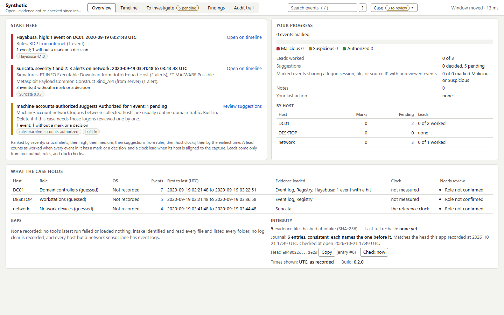
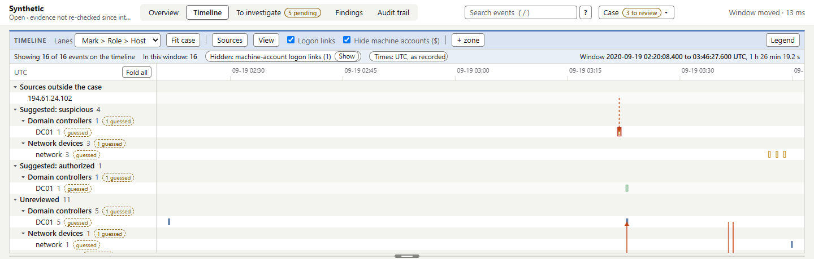
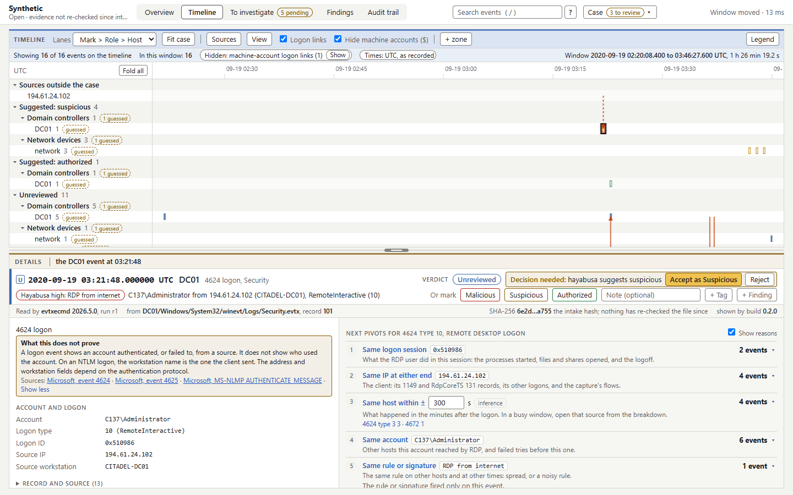

# Glessner

For a SOC analyst triaging Windows hosts, Glessner turns a triage collection into one timeline you can work. It runs the tools you already trust (Eric Zimmerman's tools, Hayabusa, and Suricata), loads every record they produce, and lets you pivot, mark, and export from one page. It runs on your own machine, uses no AI model, and makes no network calls.

Glessner is pre-alpha. Read [Limits](#limits) before you rely on it for a case.



## What it does

You point Glessner at a folder holding a collection, with one top-level folder per host, as KAPE and most collection scripts produce. Glessner then does the following:

- Hashes every file into a manifest and identifies each artifact by its header. It never writes to the evidence folder, and it re-hashes the files each tool run read.
- Runs the installed tools that read the evidence: EvtxECmd, RECmd, MFTECmd, PECmd, LECmd, JLECmd, SBECmd, AmcacheParser, SrumECmd, RBCmd, SQLECmd, WxTCmd, Hayabusa, and Suricata on packet captures. It logs each exact command line and records each tool's version.
- Loads other tools' output found in the evidence, such as a KAPE run's CSVs, Zeek's logs, Suricata's EVE JSON, and Sysinternals Autoruns CSVs. It imports text logs no tool reads: Windows Firewall, IIS, FortiGate, SonicWall, Apache, NGINX, syslog, Cisco ASA, Snort and Suricata fast alerts, and CSV or JSON-lines exports such as a SIEM's.
- Shows every event on one timeline in a local browser page, in lanes you group by mark, role, host, user, artifact, or tactic. Logon links are drawn between hosts. A host's clock can be checked against a capture and corrected with an offset, and the recorded time never changes.
- Ranks the next pivots for each kind of event, each with its reason and its count across the case before you click, and flags broad ones.
- Lets you mark events Authorized, Suspicious, or Malicious, with notes and ATT&CK tags. Hayabusa hits, Suricata alerts, four built-in rules, and your own YAML rules only suggest a mark until you accept it. The built-in `machine-accounts-authorized` suggests Authorized, and `remote-execution-pipes`, `print-spooler-pipe`, and `admin-share-executable-writes` suggest Suspicious. `rule remove ID` drops one.
- Keeps a worklist of what you marked and what is still unreviewed around it, and your findings, each with what its events do not prove.
- Writes a Markdown report, timeline exports in CSV or JSONL with ECS column names for Timesketch or Timeline Explorer, an indicators CSV, and the audit trail. Each file is hashed and recorded in the case's journal.
- Records every action in an append-only journal that is a hash chain, so a change to an earlier entry shows.





The screenshots show a small synthetic case built from the test suite's records. [glossary.md](glossary.md) names every part of the page, [scope.md](scope.md) says what the app does and leaves out, and [coverage_reference.md](coverage_reference.md) lists what it reads and which rules flag events.

## Set up

[setup.md](setup.md) sets up Glessner on a fresh Windows machine: uv and Python, a tools folder, Eric Zimmerman's tools with the .NET 9 runtime that RBCmd, SQLECmd, and WxTCmd need, Hayabusa, and Npcap, Suricata, and the ET Open rule set for packet captures.

Glessner runs on Windows. Install its Python dependencies with [uv](https://docs.astral.sh/uv/), from the folder you cloned it to:

```bash
uv sync
```

The tools aren't bundled. Put them in one tools folder, which must not hold or sit inside the evidence or case folder, since the app runs the executables it finds there. `glessner tools CASE` names the missing ones, and gives the official download page of each missing tool that reads an artifact intake identified.

Keep each case folder inside a folder your antivirus excludes. Tool output quotes attacker payloads, and Windows Defender quarantines it otherwise.

## Use

Run the commands from the folder you cloned Glessner to, or add `--project` with that folder's path. The paths below are examples.

Make a case for an evidence folder, then hash and identify every file:

```bash
uv run glessner new-case C:\Cases\CASE01 --evidence C:\Evidence\CASE01 --name "CASE01" --tools C:\Tools
```

```bash
uv run glessner intake C:\Cases\CASE01
```

Run every installed tool that has evidence, and load the tool output found in the evidence:

```bash
uv run glessner run C:\Cases\CASE01 --all
```

Open the case. The server listens on 127.0.0.1 only, and opens your browser with a link that carries the session token and works until you stop the server. It prints the link too, and `--no-browser` skips opening the browser:

```bash
uv run glessner serve C:\Cases\CASE01
```

Without a case folder, `serve` opens the start page, where you can make, open, and copy cases:

```bash
uv run glessner serve
```

The **Tools** page, in the **Case** menu, runs tools from the page. Stop the server with Ctrl+C before running tools from the command line, because both need the events database.

For a single-host collection, add `--host NAME` to `new-case`. A folder of event logs from many machines loads as one host, and the Hosts panel then offers to split it by the computer each event records.

When the work is done, close the case. Closing re-hashes every evidence file, checks the journal's chain, and prints the journal's head. Record the head outside the case folder, such as in your ticket, and check a copy later with `glessner verify CASE --journal --expect-head HEAD` or with `scripts/check_journal.py`, which needs only Python.

```bash
uv run glessner close C:\Cases\CASE01
```

### Commands

Each command takes the case folder first. `new-case` makes that folder, `copy-case` takes the source case before the new one, and `serve` runs without one to show the start page. `glessner --version` prints the build and exits. A command that is refused, such as for a missing case, prints why and exits 2. `run` and `load-output` exit 1 when a run or load fails or finds the evidence changed, `import` when a file needs a choice or its load fails, `verify` and `close` when an evidence file doesn't match the manifest, and `rebuild` and `copy-case` when they leave a run out because its output or evidence changed. `verify` also exits 1 for a journal problem it prints: no `journal.jsonl`, a case below format 3 checked with `--journal`, a broken chain, a last line with no line end or one cut short, bytes after the last line while another program holds `journal.lock`, a `journal_torn_*.bin` file the journal names that is missing or changed, an `--expect-head` (or, without one, the head this computer recorded) that isn't in the journal, or a `--file` not recorded at or before the head.

| Command | What it does | Options |
|---|---|---|
| `new-case CASE` | Make a case folder for an evidence folder | `--evidence` and `--name` (required), `--tools`, `--analyst` (default: your Windows user name), `--host` for a single-host collection |
| `copy-case SOURCE CASE` | A clean copy: same evidence, intake, and runs, and a new journal whose first entry names the source; reloads the events | `--name` (required), `--analyst` |
| `intake` | Hash and identify every evidence file | `--add` for files new since intake |
| `tools` | Installed tools with versions and paths, and recommended missing ones | |
| `run` | Run a tool on each host's evidence and load its output | `--tool ID` or `--all`, `--host` (repeatable), `--option ID=VALUE` |
| `load-output [KIND]` | List found output, or load one kind of it | `--host` (repeatable), `--anyway` |
| `import [FILES]` | Import text logs from the evidence folder | `--list`, `--preview`, `--mapping`, `--zone`, `--year`, `--host`, `--host-field`, `--time-field` (twice for a date and a time field), `--time-format`, `--format`, `--layout`, `--delimiter`, `--artifact`, `--save-as` |
| `runs` | List the runs with their status and rows | |
| `rebuild` | Recreate the events database from the latest successful run of each tool and host | |
| `serve [CASE]` | Open the case, or the start page without one | `--port`, `--no-browser` |
| `rule OP [TARGET]` | `list`, `add` or `change` a rule from a YAML file, or `remove` one by ID | |
| `export` | Write a timeline file to `exports\` | `--start`, `--end` (ISO 8601 UTC, for `--marks all`), `--format csv` or `jsonl`, `--marks all`, `marked`, or `flagged` (marked and flagged cover the whole case) |
| `findings` | Write the Markdown report to `exports\` | |
| `verify` | Re-hash every evidence file against the manifest, then check the journal's chain | `--journal` checks the journal alone, writing nothing; `--expect-head HEAD` compares it with a head you recorded; `--file FILE` checks that a file the case wrote is recorded at or before that head |
| `close` | Re-hash every evidence file, check the journal's chain, record the case as closed, and print the journal head | |

## Limits

- Pre-alpha. Expect changes to the page and the case format. A newer build upgrades a case when it opens it, and an older build then refuses that case, so work on copies.
- No blind round yet. The app has been checked against public practice cases whose answers are published, and no analyst has yet worked a case with it without knowing the answer.
- About 10 hosts per case. The performance figures come from synthetic cases built from copies of two hosts: 5.2 million events on 10 hosts, and 10.5 million. A real collection of that size hasn't been tried.
- No network calls is a tested claim for the app itself: a test checks it across a case load, a search, and every export. The tools it runs are separate programs, outside that test.
- Windows only, for the analyst's machine and for the hosts' own artifacts. Text logs from other systems, such as syslog, can be imported.
- [known_limitations.md](known_limitations.md) lists the known limitations in full, with what you can do about each.

## How it compares

Other tools work on the same evidence. They differ most in who makes the first judgment and in what the analyst reads. These descriptions come from each project's documentation as read in October 2026.

- [Valhuntir](https://github.com/AppliedIR/Valhuntir), from AppliedIR, takes a different approach, with AI in the loop: an LLM client runs forensic tools on a Linux host and drafts findings, and the examiner approves each one with a signed decision.
- [Cyber Triage](https://www.cybertriage.com/), from Sleuth Kit Labs, is a commercial Windows application whose engines score each item before the analyst looks, and the analyst confirms or overrides the scores one host at a time.
- [Plaso](https://github.com/log2timeline/plaso) builds a super timeline from files and disk images, with one event for each timestamp a record holds.
- [Timesketch](https://github.com/google/timesketch) is a web platform, run as a set of server containers, where a team searches, tags, and comments on timelines such as Plaso's.
- [Zircolite](https://github.com/wagga40/Zircolite) runs Sigma rules over event logs by converting each rule to SQL, and its packaged viewer shows a run's events and detections in the browser, with one timeline lane per ATT&CK tactic and no analyst marks or notes.

In Glessner the first judgment is the analyst's. Every record from the tools you run goes on one timeline with lanes per host, and nothing is marked until you mark it.

## Feedback

Report a bug or send feedback through the repository's [issues](https://github.com/joshuacodysmith/glessner/issues), where you choose the feedback form or the bug report form. Each form asks you not to attach evidence, case files, or real incident data. Report a security problem privately, as [SECURITY.md](SECURITY.md) describes.

## Tests

```bash
uv run pytest
```

The suite runs in parallel with pytest-xdist. Add `-n 0` to run one test at a time, as `print` output and a debugger need.

Tests marked `lab` run the real tools on local copies of public datasets, chiefly the Stolen Szechuan Sauce, at the paths the tests name, and are skipped when those copies are absent. Tests marked `browser` drive the installed Microsoft Edge through Playwright against small synthetic cases; set `GLESSNER_BROWSER_CHANNEL=chrome` to use Chrome. Tests marked `lint` run ruff and ESLint. To skip a group, deselect its marker:

```bash
uv run pytest -m "not lab"
```

ESLint, which lints the page's modules, comes from npm. `package-lock.json` pins it and its dependencies. ESLint 10 needs Node.js 20.19, 22.13, or 24 and later. The suite skips the ESLint check only when Node.js or the npm install is missing.

```bash
npm ci --ignore-scripts
```

```bash
uv run python scripts/lint.py
```

## Licenses and credits

Glessner is under the MIT license; see [LICENSE](LICENSE).

Glessner runs these tools and bundles none of them. Each is under its own license, as its publisher states:

| Tool | Publisher | License |
|---|---|---|
| EvtxECmd, RECmd, MFTECmd, PECmd, LECmd, JLECmd, AmcacheParser, SrumECmd, RBCmd, SQLECmd, WxTCmd | Eric Zimmerman | MIT |
| SBECmd | Eric Zimmerman | Free; license terms not published |
| Hayabusa | Yamato Security | AGPL-3.0, with its rules under the Detection Rule License 1.1 |
| Suricata | OISF | GPL-2.0 |

Suricata's alerts need a rule set, such as ET Open, which you download separately under its own terms. `scripts/suricata_rules.py` builds the rule file Glessner's Suricata runs use from an unpacked ET Open set.

The ATT&CK technique list is MITRE's Enterprise ATT&CK v20.0. © 2026 The MITRE Corporation. This work is reproduced and distributed with the permission of The MITRE Corporation. `src/glessner/attack_techniques.json` carries MITRE's license, and `scripts/attack_list.py` builds the file again from a later release.

Datasets:

- [The Stolen Szechuan Sauce](https://dfirmadness.com/the-stolen-szechuan-sauce/), a case from [DFIR Madness](https://dfirmadness.com/) by its founder, James Smith. Many of the test suite's synthetic records take its host names, domain, and addresses, and the lab tests run on local copies of its collections.
- [EVTX-ATTACK-SAMPLES](https://github.com/sbousseaden/EVTX-ATTACK-SAMPLES), by sbousseaden, under the GPL-3.0 license.
- The [Malware-Traffic-Analysis.net](https://www.malware-traffic-analysis.net/) [exercise of 2016-01-07](https://www.malware-traffic-analysis.net/2016/01/07/index.html).

The app was checked against all three. This repository holds none of their files.

Glessner is named for Frances Glessner Lee, whose models trained investigators to observe before they conclude. [about_the_name.md](about_the_name.md) says what the app takes from her work.

## How it was built

Joshua Cody Smith designed Glessner and directed its build. AI coding agents wrote the code: Anthropic's Claude Code built it, and OpenAI's Codex reviewed the codebase and several of the larger changes. Joshua Cody Smith's part was the design, the DFIR judgment behind each artifact, pivot, and caveat, and the verification against cases with known answers. Commits that an agent wrote carry its Co-Authored-By line.

## Files

| Path | Contents |
|---|---|
| [CHANGELOG.md](CHANGELOG.md) | What each release holds |
| [setup.md](setup.md) | Setting up the app and its tools on a fresh Windows machine |
| [known_limitations.md](known_limitations.md) | What the app doesn't do yet, or doesn't do well |
| [scope.md](scope.md) | What the app does, what is planned, and what it leaves out |
| [glossary.md](glossary.md) | The names for every part of the page and the data, including the search syntax |
| [coverage_reference.md](coverage_reference.md) | What the app reads, what reaches the timeline, the rule sets that flag events, and the Windows sources it doesn't cover yet |
| [about_the_name.md](about_the_name.md) | The namesake, Frances Glessner Lee, and what the app takes from her work |
| [SECURITY.md](SECURITY.md) | How to report a security problem |
| [.github/ISSUE_TEMPLATE/](.github/ISSUE_TEMPLATE/) | The feedback form and the bug report form for issues, with blank issues turned off |
| [LICENSE](LICENSE) | The MIT license |
| [src/glessner/](src/glessner/) | The app: the Python package, the page's modules, and its data files |
| [registry/](registry/) | One YAML file per tool, which tells the app how to find, run, and read it, and the list of other known tools |
| [scripts/](scripts/) | `check_journal.py`, which checks a case journal's chain without the app; `suricata_rules.py`; `attack_list.py`; and `lint.py` |
| [tests/](tests/) | The test suite, with `tests/perf/` for performance checks run by hand |
| [docs/screenshots/](docs/screenshots/) | The screenshots in this file |
| `pyproject.toml`, `uv.lock`, `.python-version` | The Python package, its dependencies, the Python version, and the pytest and ruff settings |
| `package.json`, `package-lock.json`, `eslint.config.mjs` | ESLint and its settings for the page's modules |
